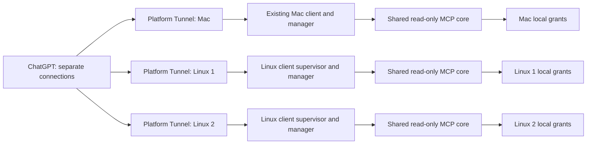

# Independent macOS and Linux nodes

## Terminal wizard SOP

The recommended Linux entry is `sudo bash scripts/install_linux_node.sh` from a reviewed checkout containing the scripts. Existing Mac defaults and Keychain workflow are unchanged. Manual deployment below remains a recovery/reference route; it is not a prerequisite for using the wizard.

### Prepare and install

Have root/sudo, Bash, Python3.14+ with venv/ensurepip, system Git2.28+ at `/usr/bin/git`, active systemd219+, 1 GiB free per candidate, trusted dependency access (or a complete offline wheelhouse), and an already verified official Tunnel Client. The scripts do not install/upgrade these host components. Ubuntu/CentOS are supported when these actual prerequisites hold; an old stock distro alone is not evidence of compatibility.

```bash
git clone https://github.com/liuhuijiayou/readonly-observer.git
cd readonly-observer
sudo bash scripts/install_linux_node.sh
```

The wizard collects all non-secret configuration and previews the plan before changes: public Node Name; a new Installation Directory; a new independent Instance Home; exact project path/alias; optional exact persistent Codex JSONL/alias; Tunnel Display Name; **explicit per-node Tunnel ID with no reused default**; detected Client path for confirmation or an absolute replacement; proxy enabled flag; and unique systemd Unit Name. The display name is a local label, not a Platform rename action. Runtime Key and Proxy URL are collected later only by Observer's hidden-TTY `credentials set --approve` and `credentials set --kind proxy --approve`. The shell and deployment controller never receive these values.

Approve the resolved commit/public snapshot fingerprint before trusted code is built as root. Local HEAD can use the current public-file snapshot, shown by its SHA256 and requiring approval; `--ref COMMIT_OR_TAG` normally exports committed bytes. Missing refs clone only the official public Observer repository into a private temporary cache; no checkout is reset or cleaned. Project/session grant previews then require their own literal `approve`. Session metadata mapping can require a second confirmation. Refusal stops immediately. Unit contents are displayed only after the local 13-tool probe and systemd verification pass; approve the precise writable paths. Finally type `start` to start and enable at boot, or leave blank to keep it stopped and disabled.

Defaults put installation code in `/opt/readonly-observer-nodes/<node>` and the home in `/var/lib/readonly-observer/<node>`. They must be separate, root-controlled and outside observed projects. Installation/home paths use simple ASCII absolute paths for old systemd compatibility; data project/session paths can contain spaces and are passed as literal argv. Symlinks, broad/unsafe roots, overlapping paths and existing homes/units are rejected. The installed Python venv is created at its permanent versioned path and never moved. No inbound port, firewall, user-account or Platform permission changes occur.

### Preview, metadata flags and offline use

```bash
sudo bash scripts/install_linux_node.sh --help
sudo bash scripts/install_linux_node.sh --dry-run
sudo bash scripts/install_linux_node.sh --no-start
sudo bash scripts/install_linux_node.sh --ref REVIEWED_COMMIT_OR_TAG
sudo bash scripts/install_linux_node.sh --python /absolute/python3.14 --wheelhouse /absolute/trusted/wheels
```

`--dry-run` prompts for missing non-secret metadata, previews it, and does not read credentials, build a venv, create targets or change/start units. For a headless dry-run, supply all required non-secret fields with `--name`, `--install-dir`, `--home`, `--project`, `--alias`, `--tunnel-name`, `--tunnel-id`, `--client`, `--proxy on|off`, `--unit`, and optional `--session/--session-alias`. `--source` chooses an already reviewed local Git checkout; `--local-reviewed` explicitly selects its public working-tree snapshot. There is no secret argument, environment/stdin key fallback, `--yes` or unattended approval mode. Real installation requires `/dev/tty` even when metadata is prefilled.

SSH-shell HTTP_PROXY/HTTPS_PROXY/ALL_PROXY values are not inherited by Git, pip, Observer or Client. Use direct approved public package connectivity or `--wheelhouse` plus a local `--source` containing the desired ref. The wheelhouse must contain the pinned build and runtime dependencies; it is trusted executable input. A partial wheelhouse fails closed instead of falling back to an unaudited installer. No Tunnel Client is downloaded or executed for detection; the operator is responsible for its provenance.

### Independent credentials and partial-install recovery

Issue a new independent Platform Tunnel and Restricted Runtime Key for each simultaneously online node. Confirm `independent-key` before entering the key. An optional Linux guard inside the existing hidden CLI rejects a key fingerprint already registered to another home on the same host. Root-only claims under `/var/lib/readonly-observer-deployments/` store one-way fingerprints/ownership, never key values. Tunnel claims similarly detect managed-host reuse. Cross-machine uniqueness cannot be proven offline: independently issue the key in Platform and explicitly attest it. Root can bypass local controls; no central Observer or cross-host registry is introduced.

On Ctrl+C or failure, temporary metadata/build/cache resources created by that operation are cleaned, while the owned journal, completed approvals and secure credential sources remain for recovery. Existing instances are never deleted. Resume only the exact original owned plan:

```bash
sudo bash scripts/install_linux_node.sh --resume --install-dir /absolute/original/installation
```

Existing credential slots require an explicit `keep` or `rotate`, with no default overwrite. Keeping a runtime key checks only the saved ownership note and source metadata, not its value; a changed/unclaimed slot requires explicit rotation through Observer. Resume reconciles matching grants and does not register them again. Unknown/foreign homes or units, changed plans and altered managed files refuse takeover. A complete installation uses upgrade, not reinitialization. A still-running incomplete owned service requires explicit approval to stop before resume. Keep the single-unit-per-home rule.

### Upgrade and rollback

Installer-managed homes contain private deployment metadata linking their exact unit and retained release. Hand-installed instances without this metadata are refused; use the manual recovery procedure rather than silently adopting them.

```bash
sudo bash scripts/upgrade_linux_node.sh --home /var/lib/readonly-observer/linux2 --ref REVIEWED_COMMIT_OR_TAG
sudo bash scripts/upgrade_linux_node.sh --home /var/lib/readonly-observer/linux2 --ref REVIEWED_COMMIT_OR_TAG --dry-run
sudo bash scripts/upgrade_linux_node.sh --home /var/lib/readonly-observer/linux2 --ref REVIEWED_COMMIT_OR_TAG --no-start
sudo bash scripts/upgrade_linux_node.sh --home /var/lib/readonly-observer/linux2 --rollback
```

A full commit SHA or exact tag is required for upgrade; mutable branch shortcuts are not accepted. Verify the current manifest, node identity, exact unit hash/origin and absence of drop-ins before stopping anything. Approve stop/update, then back up only known configuration, the old unit and state **metadata**. Credential files are never opened or backed up. Build a new release/venv, validate existing grants and local MCP, generate/verify the new unit, review and approve it, atomically replace only the unchanged managed unit, and explicitly confirm `start` for the final acceptance probe. Instance home, node identity, source grants, Tunnel and credentials are preserved; no reapproval or key entry occurs.

Old releases remain at their original absolute paths. A build/start/acceptance failure restores the previous unit/version and its previously running state when approved, unless `--no-start` was requested. A refusal or Ctrl+C restores files but leaves the service stopped. Backup `RESTORE.txt` and `upgrade-state.json` describe recovery. A power loss/SIGKILL can be recovered explicitly:

```bash
sudo bash scripts/upgrade_linux_node.sh --home /var/lib/readonly-observer/linux2 --resume --no-start
```

This recovers the recorded prior version; retry the desired ref afterward. Unknown external unit edits are never overwritten, even during recovery. Failed recovery can require manual inspection; the old unit backup and venv are retained. Do not copy stale inode-based approvals or credentials from backups. Upgrades preserve prior boot enablement; `--no-start` leaves the service stopped now, without changing that prior enablement. Retained releases/backups consume disk; there is no automatic destructive pruning.

### ChatGPT and evidence

After installation, output includes Node Name, local Tunnel Display Name, Tunnel ID, unit and source revision. Create each ChatGPT MCP connection manually, select that node's existing Tunnel, and verify observer_info.node, 13 read-only tools and an approved harmless marker. No remote-ready claim is inferred from local tests. Systemd219–246 staging and 247+ LoadCredential use the existing backend selector. Root-only plaintext persistent sources, tmpfs swap and same-UID/root limits still apply. See the [wizard test audit](linux-wizard-audit.md), [219 security differences](systemd219.en.md), and manual recovery steps below.


The same repository supplies the same 13 read-only MCP tools on both platforms. Each machine reads its own explicitly approved sources. There is no central Observer, shared file server, or remote authorization command. Use one private instance home, one independent Tunnel ID and one independently issued runtime key per simultaneously running node. A second instance on the same machine uses another `--home`.

This change adds Linux adapters. Existing macOS settings v1, default paths, approval records, Keychain service/account, manager, MCP server and Tunnel launch behavior remain in place. An existing Mac needs no reinitialization, new grants, credential migration, or reinstall to keep using its current deployment. Publication status must be checked against the actual reviewed Git revision; local commits do not prove a remote push. See [中文部署说明](deployment.zh-CN.md) and [verification audit](implementation-audit.md).

Systemd 219–246 uses a restricted RuntimeDirectory staging backend; see the [version-specific deployment and security differences](systemd219.en.md). This supersedes the former 247+ minimum. The Manager Provider never falls back to source files.

## Architecture and compatibility



`cli.py` selects Linux modules by platform and imports them only on Linux. `profile.py`, `credentials.py`, `runtime.py` and `server.py` retain the original macOS implementation. Shared changes add an optional public node identity to `observer_info`, and Linux-only Git and directory race checks. MCP names and argument schemas are unchanged:

`observer_info`, `workspace_list`, `workspace_read`, `workspace_glob`, `workspace_search`, `session_list`, `session_read`, `session_search`, `session_state`, `git_status`, `git_diff`, `git_history`, `evidence_link`.

A Linux instance adds these private sidecars to the existing layout:

| Location | Purpose |
| --- | --- |
| `config/node.json` | Random public node ID, operator-selected public display name, active/retired status |
| `config/linux.json` | Optional `{"format":1,"proxy":true}`; default is false |
| `credentials/runtime`, `credentials/proxy` | Optional 0600 local staging sources for systemd `LoadCredential`; never normal configuration or backups |
| `state/node-active.json`, `state/linux-active.json` | Frozen platform settings for the running instance |
| `state/manager.lock`, `state/*.sock` | Instance lease and private endpoints |
| `state/last-error.json` | Static error code, no raw exceptions or client output |

All instance directories are 0700, configuration and state files 0600. Do not put instance homes inside observed projects. Keep homes short enough for Unix sockets (100 encoded bytes including `/state/control.sock`), with no symlink ancestors. All working caches and sockets remain per instance. Linux additionally binds a UID-scoped abstract Unix socket using a hash of the Tunnel ID as a host-local lease. The kernel releases the lease after all owning descriptors close; it has no filesystem artifact, credentials or protocol, and remains effective across systemd PrivateTmp namespaces. It is not a central registry. It cannot prevent another machine or UID using the same identity: operators must allocate separate tunnels/keys and inventory them in Platform.

A new Linux instance gets a random node identity. Existing v1 instances do not have to upgrade; a legacy public identity is derived from the instance home without revealing the path. `node set` is optional on Mac. Names must be public ASCII labels, maximum 64 characters; do not use host addresses, secrets or private inventory details. `observer_info.node` reports only the ID, name, schema version and lifecycle status, not hostname/IP, OS accounts, Tunnel ID, credential path or key.

## Fresh Linux server: complete procedure

Prerequisites: CPython **3.14+** with venv/pip, Git **2.28+**, Linux with systemd **219+** (legacy checked tmpfs staging; native `LoadCredential` from 247), and the operator-installed official Tunnel Client. Ubuntu 22.04/systemd 249 is a deployment target; Ubuntu's default Python is insufficient. Install Python 3.14 using your approved distribution method. No core-code change is needed. Confirm versions first:

```sh
python3.14 --version
git --version
systemctl --version
```

The following root example uses dedicated installation and instance directories. It does not create or change users. Replace the instance name for every node or additional local instance.

```sh
git clone https://github.com/liuhuijiayou/readonly-observer.git /opt/readonly-observer
cd /opt/readonly-observer
# Select a reviewed revision containing the Linux adapters.
python3.14 -m venv /opt/readonly-observer/.venv314
/opt/readonly-observer/.venv314/bin/python -m pip install .
OBSERVER=/opt/readonly-observer/.venv314/bin/observer
INSTANCE=/var/lib/readonly-observer/linux1
"$OBSERVER" --home "$INSTANCE" init --non-interactive
"$OBSERVER" --home "$INSTANCE" node set --name codex-observer-linux1
"$OBSERVER" --home "$INSTANCE" project add /absolute/authorized/project --alias app
"$OBSERVER" --home "$INSTANCE" config validate --check-sources
"$OBSERVER" --home "$INSTANCE" doctor --level local --probe
```

Read the local confirmation previews; type `approve` only for exactly the intended source. `--approve` can replace interactive confirmation when the local operator explicitly chooses automation. Initialization does not grant any sources or start anything. Git remains optional for ordinary source/session reads, required for Git/evidence tools. Test a harmless public marker through local MCP before connecting remotely.

To authorize a Codex session, select **one exact persistent JSONL file** locally:

```sh
"$OBSERVER" --home "$INSTANCE" session add /absolute/selected/rollout.jsonl --alias task
```

The registration checks metadata and records the file's identity. Optional `--reference` explicitly maps a cloud task link/ID. Do not grant an entire Codex history directory. Missing ephemeral logs cannot be recovered. Sessions only expose recognized public content; no hidden reasoning or `auth.json` is required.

### Independent Tunnel and credentials

In [Platform tunnel settings](https://platform.openai.com/settings/organization/tunnels), create a separate Tunnel for this node. Associate the intended Platform organization and ChatGPT workspace. Create an independent restricted runtime key for this node with Tunnels **Read + Use**, using a suitably authorized principal. Tunnel creation/editing requires **Read + Manage**; ChatGPT access is a separate workspace permission. These distinctions are documented in the [official Secure MCP Tunnel guide](https://developers.openai.com/api/docs/guides/secure-mcp-tunnels) and [official client permissions](https://github.com/openai/tunnel-client/blob/master/docs/permissions.md).

Download/install the official client from Platform or the [official latest release](https://github.com/openai/tunnel-client/releases/latest), verify it using your software supply-chain policy, and keep its absolute installed path. Observer does not download, bundle or execute an unreviewed installer. The executable must be owned by the service's OS user, executable and not group/world writable. For a root service, install it root-owned. Check its offline help for the installed version before deployment; do not run client `doctor` against real credentials as part of synthetic tests.

```sh
/absolute/installed/tunnel-client help quickstart
/absolute/installed/tunnel-client run --help
"$OBSERVER" --home "$INSTANCE" transport tunnel \
  --client /absolute/installed/tunnel-client --tunnel-id '<NODE_TUNNEL_ID>'
"$OBSERVER" --home "$INSTANCE" credentials info
"$OBSERVER" --home "$INSTANCE" credentials set
```

Enter the **existing restricted runtime key** at the hidden local terminal prompt. There is no key argument, piped-stdin or ambient-key fallback. On Linux this stages a private source file for the selected systemd backend; it does not create a remote key. Source files are plaintext protected by OS permissions; they are **not encrypted at rest**. Ubuntu 22.04/systemd 249 uses `LoadCredential`, not newer encrypted-credential directives. A managed secret service may supply the source instead: adapt the rendered unit's `LoadCredential=<exact_id>:<approved_source>` locally while retaining the exact ID from `credentials info`. Do not place literals in units, JSON, environment files, shell history or Git.

At runtime the Linux provider reads only `$CREDENTIALS_DIRECTORY/<instance_id>`, with no-follow, owner, mode, link, size, ASCII and before/after identity checks. Missing/unsafe credentials stop startup. It does not read the staged source directly, `OPENAI_API_KEY`, another instance's credentials or any Keychain. The systemd directory itself is provided per unit; metadata validation does not defend against a malicious process with the same UID.

### Optional outbound proxy

```sh
"$OBSERVER" --home "$INSTANCE" credentials set --kind proxy
"$OBSERVER" --home "$INSTANCE" proxy enable
```

Enter an HTTP(S) proxy URL at the hidden prompt, including authentication only there if required. The URL is stored in a separate secure slot, never ordinary config. Only `proxy=true` is configured. `proxy disable` removes use of the slot at the next restart. No inherited `HTTP_PROXY`, `HTTPS_PROXY`, `ALL_PROXY` or `NO_PROXY` is copied.

The [official client configuration reference](https://github.com/openai/tunnel-client/blob/master/docs/configuration.md) documents `control_plane.http_proxy` / `--control-plane.http-proxy` / `CONTROL_PLANE_HTTP_PROXY`, including `env:VAR` references. The Linux adapter reuses the existing common `client_config` and sets `control_plane.http_proxy: env:OBSERVER_TUNNEL_PROXY`; it injects that variable only into the owned transport supervisor/client. The client's MCP command uses `env -i ... connect`, and the manager spawns Workers from an exact minimal environment. Credential-directory paths, keys and proxies are not passed to Workers. This is application/environment isolation; all processes still share the service UID.

### systemd service

Render a concrete unit, review it, then install it under a **new, unique unit name**. Do not overwrite an existing deployment:

```sh
"$OBSERVER" --home "$INSTANCE" systemd-unit > /tmp/observer-linux1.service
cat /tmp/observer-linux1.service
test ! -e /etc/systemd/system/observer-linux1.service
install -m 0644 /tmp/observer-linux1.service /etc/systemd/system/observer-linux1.service
systemctl daemon-reload
systemctl enable --now observer-linux1.service
"$OBSERVER" --home "$INSTANCE" status
"$OBSERVER" --home "$INSTANCE" doctor --level local --probe
```

Inspect the `test` result before `install`; it must succeed. The unit runs the installed Python module in isolated mode. Keep the venv at its installed path. The service uses foreground `run`, per-instance `LoadCredential`, `KillMode=control-group`, `UMask=0077`, `LimitCORE=0`, filesystem read-only mounts except the instance home, and suppressed raw client output. It runs as root in this example. To use an existing non-root identity later, review its source access, binary ownership and filesystem permissions explicitly; no user changes are performed by Observer.

With systemd, use `systemctl stop/start/restart observer-linux1.service` for lifecycle. Calling `observer stop` alone while an enabled service is supervised can lead to a service restart after failures. `observer start/stop` remains available for independently launched local instances; Tunnel startup requires a systemd credential context. `serve` and local stdio need no credentials. No inbound firewall change is required by the tunnel architecture; Observer does not modify any network policy.

In ChatGPT create a separate custom MCP connection/plugin named `codex-observer-linux1`, choose Tunnel and this node's ID, select the appropriate authentication and workspace permissions, and review the tool scope. Repeat with distinct Tunnel, key, home, unit and connection names for Linux 2 and future nodes. Keep the current Mac connection intact. Verify `observer_info.node`, exactly 13 read-only tools, and one approved harmless marker **through each actual ChatGPT connection**. Process status and local probes do not establish remote readiness.

## Stop, crash recovery, rotation, replacement and revocation

| Action | Local operation | Remote operation still required |
| --- | --- | --- |
| Normal stop | Stop the relevant systemd unit; check `status` | None; remote grants and connection still exist |
| Crash/recovery | Stop unit; `recover --approve`; start unit | None unless compromise is suspected |
| Remove one local grant | Stop relevant managed/direct Workers; `project/session remove`; explicitly restart | Runtime key/Platform/ChatGPT remain unchanged |
| Revoke all local grants | Stop unit; `revoke --approve` | Revoke runtime key and relevant access separately if needed |
| Retire node | Stop and disable unit; `node retire --approve` | Revoke runtime key, Platform Use/associations or Tunnel, and ChatGPT connection as intended |
| Rotate runtime key | Stage a newly issued independent key; restart unit to reload credentials | Issue new restricted key and explicitly revoke old key in Platform |
| Replace machine, keep connection | Stop old node; initialize new home; reapprove local sources; optionally set old public node ID/name; configure same Tunnel ID with a new key | Issue new restricted key; revoke old key; verify retained ChatGPT connection |

Examples after stopping the unit:

```sh
"$OBSERVER" --home "$INSTANCE" recover --approve
"$OBSERVER" --home "$INSTANCE" revoke --approve
"$OBSERVER" --home "$INSTANCE" node retire --approve
# Optional local deletion, after remote revocation is handled separately:
"$OBSERVER" --home "$INSTANCE" credential-delete --kind runtime --approve
```

Recovery holds the manager lease, refuses if any manager/owned Worker/supervisor still holds it, and removes only known safe runtime artifacts. It refuses symlinks, foreign owners, unexpected types or permissions and leaves other files alone. It never guesses PIDs, kills unrelated processes or removes locks to force takeover. A failed review requires local inspection. `ExecStartPre` invokes this same bounded recovery after systemd has stopped the preceding control group. Workers and the client supervisor also monitor a parent pipe: manager SIGKILL closes the pipe and shuts them down. A client failure stops the manager; systemd can restart it. No reconnect state is a claim of successful remote calls.

`revoke` stops only the instance-owned manager and clears current local grants. `node retire` additionally blocks new Linux Workers until explicit `node activate --approve`. Activation restores no grants. Private backups can contain old grants but are not automatically applied. Independently launched direct `serve` processes and legacy entry points must also be stopped by their owning client/operator; they are outside the managed lease. Retirement is an operator lifecycle flag, not an OS-level defense against the trusted local user running legacy commands.

Deleting `credentials/runtime` removes only the staged local source. A running unit may retain its already loaded copy until stopped; deleting a file is not remote key revocation. On Mac, remove an unneeded Keychain item through existing local administration; its implementation and defaults are unchanged.

The official client accepts an existing Tunnel ID and a separately supplied runtime key. **Inference from that documented separation:** a replacement host can reuse the existing ID with a new suitably authorized key, preserving the ChatGPT connection's target. No automatic identity transfer or Runtime Key “reissue for a tunnel” API is implemented or assumed. Issue a new restricted key for an authorized principal, stop the old host, revoke the old key in Platform, then verify the retained connection. If account policy/associations prevent this, create a new Tunnel/ChatGPT connection. Never run old and new hosts simultaneously with the same Tunnel identity. Do not copy active sockets, frozen state, key files, credentials, caches or inode-based approvals to a new machine.

For retirement, distinguish four scopes: local data grants; the old runtime API key; the principal's Platform Tunnel Use permission and tunnel organization/workspace associations (or deletion of the tunnel); and the ChatGPT connection/workspace permission. Each requires its own explicit operator action. Do not remove a shared principal's role or a retained tunnel needed by other nodes. Observer has no admin API key and reports remote revocation as **not performed**.

## Root boundary and verification

Root can read other users' files, inspect process environments/memory, bypass ordinary mode bits and change source files outside the application. Read-only MCP tools do not reduce root's OS authority. The generated systemd filesystem restrictions protect against ordinary writes by the service, but do not turn a compromised root host into an isolated tenant. Do not authorize broad home/system roots or place credentials inside approved projects. Run trusted installations; a dedicated non-root account is a later operator choice, not an automatic migration.

Run synthetic checks without authorizing personal data or starting a real Tunnel:

```sh
python3.14 -m venv .venv-test
.venv-test/bin/python -m pip install .
.venv-test/bin/python -I scripts/test_suite.py
.venv-test/bin/python -I scripts/check_repository.py
```

`--git /absolute/isolated/git` on `scripts/test_suite.py` selects a modern Git **only within the test process**, for hosts with an obsolete system Git. Production continues using the existing trusted `/usr/bin/git`. Upgrade the server's Git through approved administration before using production Git tools. The supplied CI targets Ubuntu 22.04 and macOS 14 with Python 3.14; hosted execution is pending. Linux CI additionally runs root-only wizard/hidden-TTY tests, `scripts/linux_wizard_smoke.py` install/upgrade/rollback, and `scripts/systemd_smoke.py` credential lifecycle checks. Smoke scripts use the actual Manager's backend, synthetic credential material and a fake client, and install/remove only uniquely named ephemeral test units. No real keys, sessions, tunnels or remote calls are used. Consult the wizard audit for actual local results and pending platform/remote acceptance.
